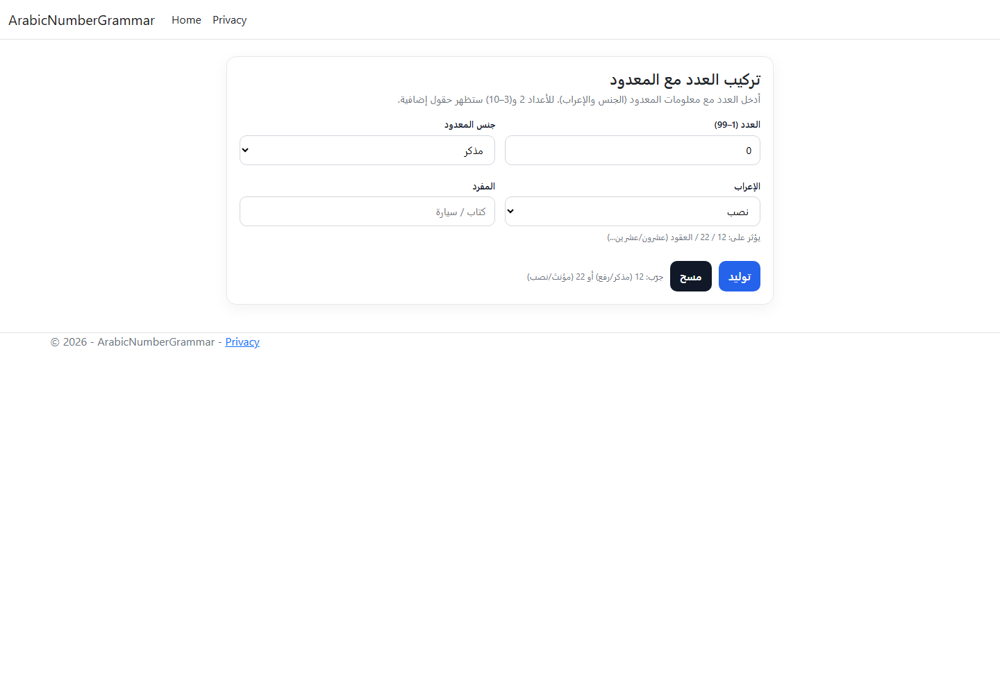
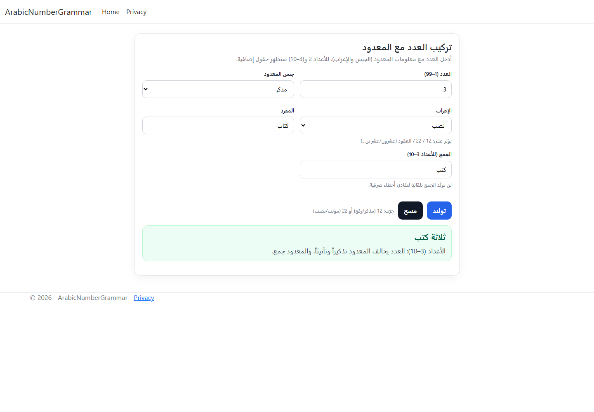
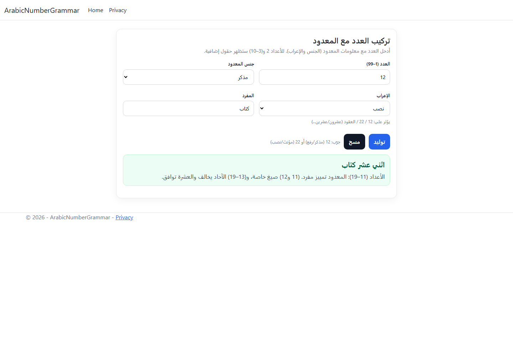

# Arabic Number Grammar

An Arabic web tool for composing number–noun phrases from 1 to 99 and explaining the agreement rule used. Built with ASP.NET Core MVC and a separate C# grammar composer.

## Features

- Select a number, noun gender, and grammatical case: nominative, accusative, or genitive.
- Provide the singular noun, plus a dual form for 2 or a plural form for 3–10.
- Display the composed phrase and a short Arabic explanation.
- Validate the supported number range and required noun forms.

The application does not infer arbitrary Arabic plurals or duals. Those forms are supplied by the user; this is a focused educational tool, not a general morphological analyzer.

## Screenshots

Captured from the running local application using example nouns.



| Plural agreement | Compound number |
| --- | --- |
|  |  |

## Structure and stack

ASP.NET Core MVC, .NET 8, C#, Razor, and an Arabic RTL form. No database, account system, or external service is required.

```text
Controllers/NumbersController.cs     Form requests and results
Models/ComposeRequest.cs             Validated inputs and enums
Domain/                             ArabicNumberComposer grammar logic
Service/                            MVC-facing composition service
Views/Numbers/                      Arabic form and explanations
```

## Run locally

Install a .NET SDK supporting the .NET 8 target, then:

```powershell
dotnet restore ArabicNumberGrammar.csproj
dotnet run --project ArabicNumberGrammar.csproj --no-launch-profile --urls http://localhost:5311
```

Open `http://localhost:5311/Numbers`. No secrets or database setup is needed.

## Project status

The project built successfully and the form and two result cases were exercised locally. Screenshots show actual submitted results. Linguistic coverage is limited to the implemented 1–99 rules; comprehensive grammar tests and broader inflection support remain future work.
